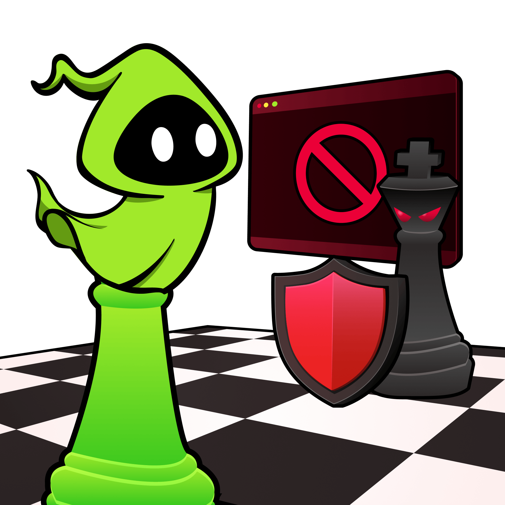

# Room: TryHearthMe 


**Infos:** <br>
Difficulty: easy<br>
Est. Time: 15min<br>
Task: Checkmate the bot.<br>
👉 Link: https://tryhackme.com/room/foolsmate <br>
<br> <br>
# 📖 Things that I learned:
<br>

## Console
The Browser-Console lets you execute JavaScript inside of the current Website, you have acsess to client-sided variables.
But you sometimes need to set a break-point otherwise it just isn't possable with the timing.
<br>
<br>

# 💡How I solved it
My first instinct was getting the JavaScript-File and find out where the exact stopping point is currently.<br>
I had to look at the Network-Response and after scrolling for a bit I actually found it. <br>
There was an If-Statment like this
```
if (isCheckmate)
{
   alert("You shouldn't do this!);
   return true;
}
```
After googling how to change values inside of JavaScript within the Browser, I saw that you could just use the console.<br> 
But I had to set a breakpoint so I could change it in the right time. <br>
Then just typed:
```
isCheckmate = false;
```
And well well well, it worked very good and I sucssesfully won the chess-game against a cheating bot
And this is how I solved the CheckMate room

<p align="center">Thanks for reading all of this, I'm trying to make better doucmentations 🚀</p>
