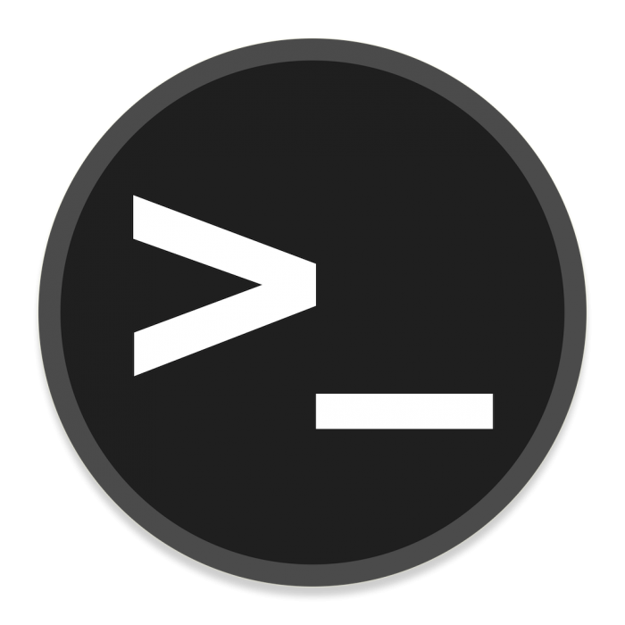

# Room: RootMe

**Infos:**  
Difficulty: medium 
Est. Time: 45 min 
Task: Find two flags and setup a reverse-shell 
👉 Link: https://tryhackme.com/room/rrootme 
 
 

# 📖 Things that I learned:

## 🐘 PHP Reverse Shell
I learned that the file extension is important when uploading PHP reverse shells. I initially uploaded my shell as `.html` instead of `.phtml`, which caused it not to work. After renaming it to `.phtml`, I was able to execute it successfully.

## 🛡️ Privilege Escalation with Python
I learned how to use Python to escalate privileges when it has the SUID permission set and runs as root.
Command: `import os; os.setuid(0); os.setgid(0); os.execl("/bin/sh", "sh")`

# 💡 How I solved the room

**⚠️ Way-in**  
I started with an Nmap scan using `nmap -sC -sV (ip)`. This allowed me to see which ports were open and which services were running. I noticed that HTTP was running on port 80.  
My next step was to check the website running on the HTTP port. Unfortunately, I couldn't find anything interesting there.  
After that, I used Gobuster to search for hidden directories:
`gobuster dir -u http://(ip):(port) -w (wordlist)`  
During the scan, I discovered a directory called `/panel`, which I immediately opened in my browser.  
The page contained a file upload function. Since my goal was to get root access, I decided to upload a PHP reverse shell. However, I accidentally saved the file with the `.html` extension instead of `.phtml`. After noticing my mistake, I renamed the file and uploaded it again.  
I then started a Netcat listener using `nc -lvnp 66` and waited for the reverse shell connection. After executing the uploaded file, I successfully gained access to the machine!  

**💥 Escalating Privileges**  
Now that I had access to the machine, I needed to find a way to become root. For this, I used the following command:
`find / -type f -perm -4000 -user root 2>/dev/null`
This command searches for files owned by root that have the SUID permission set.  
While checking the results, I noticed Python. I didn't know exactly how to use it for privilege escalation, so I had to Google it.  
Eventually, I found the following Python command:
`import os; os.setuid(0); os.setgid(0); os.execl("/bin/sh", "sh")`
By executing this command through the SUID-enabled Python binary, I successfully spawned a shell with root privileges!  
The final step was finding both flags. I used commands such as:
`find / -iname '*user*' 2>/dev/null`
to search for files that might contain the flags. After finding both flags, I submitted them and successfully completed the room!  
 

# 🛡️How could this be prevented?
There are several security issues that could have been prevented:

- **File uploads:** Uploaded files should be validated carefully. Dangerous file types such as PHP scripts should not be executable on the web server. File extensions alone should never be trusted.
- **Web directories:** Sensitive directories and file upload pages should be protected with proper authentication and access controls.
- **SUID permissions:** Never assign SUID permissions to interpreters like Python. This can allow attackers to execute commands with root privileges.
- **System permissions:** Regularly check SUID binaries and remove unnecessary or dangerous permissions.

The biggest security problem was the combination of an insecure file upload function and the SUID-enabled Python binary. These vulnerabilities allowed me to gain initial access and eventually escalate my privileges to root.
