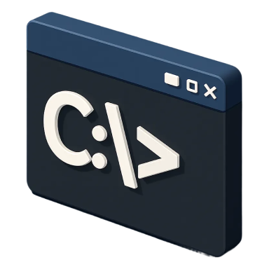

# 🌐 TryHackMe: Windows-Commandline 

I've sucsessfully completed the room and I now share my new knowlagde about it here! <br>
It covers the following commands
- SSH
- ver
- netstat
- systeminfo
- ipconfig
- cd
- tasklist
- ping
- tracert
- NSLOOKUP

👉Link to the room: https://tryhackme.com/room/windowscommandline
<br>
# 🛡️ SSH-Connection

The room startes with basic **SSH Connection** but how do you actually Connect trough SSH? <br>
I already explained it a bit in my Repo: https://github.com/MONYtry/Server/blob/main/tutorial.md <br>

But here is an better Explanation:<br>
SSH stands for Secure-Shell, what it really means is it lets an administrator of an Network enter a Server without being physicly infront of it. **(Like a Remote-Accses)**<br>

When you open up an Command-Interface and type in SSH admin@(ip) and press enter. <br> <br>

It will ask you for an Fingerprint, it tells who the server is. <br>
If you accept it the Server will never ask you again. <br>
Then you enter your password meanwhile the Server generated an cryptographic key that your PC already has as soon as the login is correct (Session Key). It is mostly saved under known_hosts.<br>
Only if the public generated key is the same as the one on the server you will grant accses otherwise you will get a big error message saying that your key isnt correct or you are a **MIT (Man-In-The-Middle Attacker)**<br>
Now we are inside of the SSH Connection, and with my knowladge it is not possible to read the Data-Flow between the User & Server. <br>

# ℹ️ Ver
The Command `ver` stands for version of something.<br>
If you type it in your CMD it will show you you're OS-Version.<br>
Most programms use it, it is almost universal.<br>

# 🔧 Systeminfo
You want to find infomations about your system?<br>
Try the Command `systeminfo` it will show things as<br>
- User
- OS
- system32 path
- Physical RAM installed
- Timezone
- Network-Adapter and so much more!

# 🛜 IPConfig
Need the IP of a Windows-System, no problem!
`ipconfig` displays every inch of it
It displays things as:
- IPv4
- IPv6
- Subnet-Mask
- Standard Gateaway
But that isnt all because if you add an /all to ipconfig (`ipconfig/all`) it will show deeper infomations about your network
- MAC
- Your Network-Adapter
- DNS-Server
- DHCP-Server and if it is enabled


# ♻️ PING
You want to know an IP / Hostname **EASY** use the Ping Command it will show you the Connection and the Hostname for example use <br>
`ping www.google.com` <br>
it will show something like this:
```
anwser from (ip): Bytes=32 Time=13ms TTL=119
anwser from (ip): Bytes=32 Time=12ms TTL=119
anwser from (ip): Bytes=32 Time=11ms TTL=119
anwser from (ip): Bytes=32 Time=12ms TTL=119

Ping-Statistic for (ip):
    Packets: Sent = 4, received = 4, Lost = 0
    (0% Lost),
Ca. Time in Millisec.:
    Minimum = 11ms, Maximum = 13ms, Middle-Value = 12ms`
```
Lets take a look at the message we've got. <br>

time = how long it took to get a respone <br>
TTL = Time to Live (in hops) but why do we actually have this? <br>
TTL is very smart because lets say you are searching for a pair of sockts but you cant find them, you dont wanna waste your day searching for them you just take a different paire right? <br>
Thats why TTL was invented because if a request wasnt received it dies after about 120 seconds. <br>
<br>
Sent = 4 means the one ping command sent four packets each packed with 32 Bytes <br>
received = 4 means we got 4 as a reponse from the target. <br>
Lost = 0 is very good it means that no packet was lost. <br>
Time in Millisec just shows us the statistics wit an min-max and middle-value in our example it is very good! <br>

# 🏃 Tracert
You wanna know how many times your request / packet hops trough a network? <br>
Use `tracert (target)` <br>
Example: 
```
> tracert google.com
  1    <1 ms    <1 ms    <1 ms  192-168-178-1 [192.168.178.1]
  2    10 ms     8 ms     8 ms  192.0.0.1
  3    10 ms     8 ms     9 ms  (your ISP) [(ISP-IPv4)]
  4    13 ms    11 ms    11 ms  89.27.238.38
  5    13 ms    11 ms    12 ms  89.27.238.39
  6    13 ms    11 ms    11 ms  dia01s04-in-f14.1e100.net [142.251.141.14]
  ```
It shows you the current hop, min-max and middle-value and the current IP-Adress where your test packet is located at.

# 🔎 NSLOOKUP
Nslookup stands for name-system-lookup and it basicly gives you tiny bits of infomation about. <br>
You can enter the interactive mode with onlye using nslookup and work from there or you just type in your wanted infomation  <br>

| Usage | Explanation |
|-------|-------|
| -type=A | Shows you the IPv4 of the target |
| -type=AAAA | Shows you the IPv6 of the target |
| -type=AAAAA | Shows you both of the IPs from the target |
| -type=MX | Shows you the mail-server of the target |
| -type=NS | Shows you the Name-Server-Record of the target |

# 🛜 Netstat
netstat -abon shows all networkconnections and open ports on your computer <br>

| Usage | Explanation |
|-------|-------|
| -a | Shows all connections and their used port |
| -b | Shows executeable files that the connection uses |
| -0| Shows you the process id |
| -n | Shows the IP and port |

Example: <br>
  ```
TCP    192.168.1.10:54321    142.250.74.14:443    ESTABLISHED    1234
  ```
- 192.168.1.10:54321 | Your PC's IPv4 and port <br>
- 142.250.74.14:443 | Remote adress and port <br>
- ESTABLISHED | means that the connection is active <br>
- 1234 | Process-ID <br>

# 📂 Navigation within the CMD

How to navigate in windows-shell <br>
use cd followed by a foldername  <br>
Example: `cd /home/downloads` <br>
If you need a preview of a file just use: `type (filename)` it is the same as the cat command on linux

# 📝 Tasklist
If your PC lags or you just wanna see what is going on, you might use the taskmanager but there is also an CMD version of it <br>
you can enter it with `tasklist` and if you need help use `tasklist /?`.  <br>
You need a specific process, use `tasklist /FI "imagename eq (process)` <br>
/FI | Filter  <br>
imagename eq means if the process name equles... <br>
And when you need to kill a process just use `taskkill /PID (processID)`

-

# 👨‍💻 About-me
As I'm writing this I'm just fifteen and I got motivated by a friend of mine. <BR>
Yesterday night I've completed about 4 Rooms but I dont have premium so cant do anything right now. Going back to coding for the next 24 hours :) <br>
I hope my explaination wasn't too bad, I made it mostly just for me to keep knowladge somewhere. Thanks

👉Link to the completed room: https://tryhackme.com/room/windowscommandline?utm_campaign=social_share&utm_medium=social&utm_content=room&utm_source=copy&share_date=2026-11-18&sharerId=6a6db5f574ab7522182287ff
