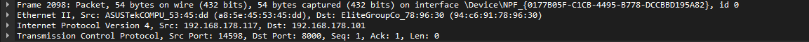

# Wireshark
A software made to read the traffic inside your network (Packet Analyzer).

# How to use it 
1. Open Wireshark.
2. Select your active network interface (Wi-Fi/Ethernet).
3. Start capturing packets.
4. Use Display Filters to find specific traffic.
5. Select a packet to inspect its details.

# 👨‍💻 Capturing traffic (Filtering)
Here are filters that I've used often but there are **MANNNYYYYY** more! <br>
| Filter | Explanation |
------|-------|
| ip.addr eq (ip) | Displays every interaction with the given IP |
| dns.qry.name == "youtube.com"| Displays every DNS-Request with that name |
| tcp | Only shows to TCP-Interactions | 
| tcp.port == (port) | Only shows TCP-Interactions inside the given port | 
<br>
<br>

# 🔎 Analyse Packets

This Image is a piece of a <a href="https://github.com/MONYtry/TryhackMe/blob/main/tcpHandshake.md">TCP-Handshake</a> between my PC and my Home-Lab 

I will use it to explain wireshark-features. <br>
<br>

# Time and size

```
Frame 1959: Packet, 85 bytes on wire (680 bits),
85 bytes captured (680 bits)
```
| Usage | Explanation|
|-------|-------------|
| Frame | Shows when the package was caught |
| 54 bytes on wire | Size in Bytes that went through the network |
| (432 bits) | Bytes -> bits that went through the network |
| 54 bytes | Size that we are able to inspect in my case it has the full length of the package which is good! |
| (432 bits) | Bytes -> bits that wireshark caught |
| 1 Byte | 8 Bits |


# Network-Adapter

```
Src: ASUSTekCOMPU_53:2a:ce (MAC Adress)
Dst: EliteGroupCo_:45:dd (MAC Adress)
```
| Usage | Explanation|
|-------|-------------|
| Src | the start-point|
| Dst | the end-point|

# IPv4
```
Src: 192.168.178.117
Dst: 192.168.178.101
```
| Usage | Explanation|
|-------|-------------|
| Src | starting-point IPv4|
| Dst | end-point IPv4 |

# TCP-Header

```
Src Port: 14598
Dst Port: 8000
Seq: 1
Ack: 1
Len: 0
```
| Usage | Explanation|
|-------|-------------|
| Src Port | Port where the comes from |
| Dst Port | Port where the request goes |
| Seq | TCP Sequence Number |
| Ack | TCP confirmation number |
| Len | TCP length of the request in Bytes |

